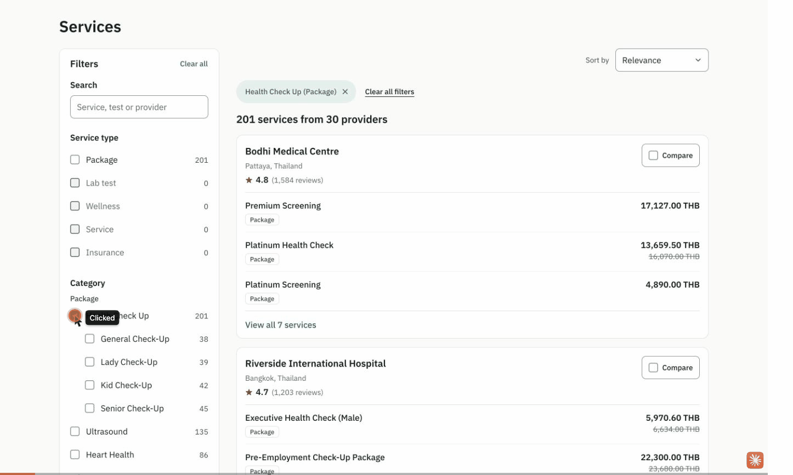

# MedEx take-home

One Next.js app for all three tasks: `/services` (service explorer), `/cart` (cart and split checkout) and `/booking` (booking across time zones).

## How to run

You need Node 24 (the version is pinned in `.nvmrc`) and npm.

```sh
nvm use        # or install the version in .nvmrc another way
npm install
npm run dev    # http://localhost:3000
```

| Command                           | What it does                                                                                                                                                                  |
| --------------------------------- | ----------------------------------------------------------------------------------------------------------------------------------------------------------------------------- |
| `npm run dev`                     | Runs the app locally at http://localhost:3000                                                                                                                                 |
| `npm run build` then `npm start`  | Production build, then serves it                                                                                                                                              |
| `npm run check`                   | Lint, type check and tests together. CI runs these plus the build.                                                                                                            |
| `npm run lint`                    | ESLint with strict type-checked, accessibility and the same Sonar rules as SonarQube for IDE, plus the "data only through the mock API" rule. Fails on any warning (ADR 0012) |
| `npm run typecheck`               | Generates Next's route types, then runs the TypeScript compiler                                                                                                               |
| `npm test` / `npm run test:watch` | Vitest, once or in watch mode                                                                                                                                                 |
| `npm run bench`                   | Vitest benchmarks: the Task 1 engine over the real data (see Task 1, Performance)                                                                                             |
| `npm run format`                  | Prettier over the code (the docs, data and design folders are left alone)                                                                                                     |
| `npm run audit:data`              | Checks the data audit counts in the specs against the raw data                                                                                                                |

## Why all three tasks

## Architecture

How the app is put together, and why: [docs/ARCHITECTURE.md](docs/ARCHITECTURE.md). The big decisions each have a record in [docs/adr/](docs/adr/).

## Task 1

`/services` finds a service across 64 providers and 2,853 visible services, and compares up to 3 providers side by side. The story it is built for: "a full-body check-up near Bangkok, under 5,000 THB, and compare a few hospitals before I commit."



What it does:

- Results grouped by provider, 3 services each, then "View all N services". 10 providers per page.
- Filters: search, service type, category and subcategory, provider, city or country, price (after a currency is chosen), home test. Each option shows how many services it would give. An option at 0 stays visible, muted.
- Sorts: relevance, price low to high and high to low (in currency sections when no currency is chosen), rating.
- Everything is in the URL: reload, a shared link, Back and Forward all show the same view, with no flash of unfiltered results.
- Below the large breakpoint, filters open in a full-screen drawer whose "Show 42 results" counts before you apply.
- Compare: tick up to 3 provider cards, then compare rating, location, matching services, price range and home tests.

### Decisions

Every decision, with what the data says and why, is in one list: [docs/specs/task1-services.md, Decisions](docs/specs/task1-services.md#decisions). The bigger choices are ADR 0004 (money), 0006 (URL and one engine) and 0011 (mock failures).

### Data mistakes and what the customer sees

| What the data says                                                                                                                                            | What the customer sees                                                                                                                    | Why                                                                                                                             |
| ------------------------------------------------------------------------------------------------------------------------------------------------------------- | ----------------------------------------------------------------------------------------------------------------------------------------- | ------------------------------------------------------------------------------------------------------------------------------- |
| Service 0005: a discount of 600 on a price of 450                                                                                                             | 450.00 THB, nothing struck through                                                                                                        | A discount larger than the price is the provider's mistake. Ignore it, keep the charge                                          |
| Service 0007: title `"  hba1c   TEST (Diabetes) "`                                                                                                            | "hba1c TEST (Diabetes)", found by "hba1c test" in any case                                                                                | Stray spaces are typos. Search ignores case, spacing and punctuation                                                            |
| Service 0004 has status false; category "Seasonal Offers" is inactive (46 services); providers 161 and 162 are inactive (113); 198 services have status false | None of them. 2,853 services are visible, not 3,200                                                                                       | One visibility rule, in `mappers.ts` only. 10 services are hidden for more than one reason                                      |
| Two top-level categories share the slug `ultrasound`; the subcategory slug `thyroid` appears 3 times                                                          | Two "Ultrasound" options, one under Package and one under Lab test                                                                        | Category keys include the type and parent (`package.ultrasound.thyroid`), so they never mix                                     |
| 22 services have no category                                                                                                                                  | An "Other" option with 20 services                                                                                                        | 2 of the 22 are hidden by the rules above                                                                                       |
| Providers 61, 105, 122, 139 and 156 have rating null and 0 reviews                                                                                            | "New, no reviews yet", last in the rating sort                                                                                            | Null is "no reviews yet", never 0 stars                                                                                         |
| Provider 163 is active and rated 4.2 but has no services                                                                                                      | Not in the provider filter, which offers 64 providers                                                                                     | Kept, it would sit at 0 for good, and the count wouldn't match the results                                                      |
| 747 times a provider lists the same title more than once, at different prices                                                                                 | Each listing separately                                                                                                                   | They are different offers                                                                                                       |
| 39 prices have a small discount and a larger service charge                                                                                                   | The struck-through price includes the charge, so it is always above the final price. 0001 shows 5,970.60 THB with 6,634.00 struck through | Striking through the bare price (6,200.00, as the handoff draws it) would show a "was" price at or below what the customer pays |
| `/category/active` returns inactive categories too                                                                                                            | Nothing extra                                                                                                                             | The mock serves the data as given; the mapper hides them                                                                        |

The other edge cases are not mistakes but are tested: 0002 (3,000.00 NPR after an amount discount), 0003 ("From 1,800.00 THB, 60 min") and 0006 ("Free").

### Trade-offs

- **All 3,200 services load in the browser**, so counts update with no round trip. Fine at this size, not at 300,000 (ADR 0006).
- **Simpler controls than the handoff:** the provider filter is a name box over the checkbox list, not a popup combobox; location and sort are native selects; price is two boxes, no slider; on a phone the comparison table scrolls sideways instead of a carousel. Fewer dependencies and less to explain.
- **Filters write the URL with the history API, not the router**, so a change costs no server round trip. Search is sent at most every 250 ms, because Safari throws after 100 history changes in 10 seconds; results can trail typing by that much, but the box shows every letter at once.
- **Options at 0 are disabled in place, not hidden**, so lists don't jump. Easy to switch.
- **Search needs the whole phrase in one field**: "thyroid riverside" finds nothing. Simple to explain; matching words across fields is the next step.

### Left out and next

- **At 4x CPU a tick can take more than 100 ms to show.** Over 60 changes on 29 Oct: median 104 ms, p95 207 ms to the commit. Over 5 changes on 30 Oct: median 75 ms, p95 100 ms. The time is React rendering the results and the panel. Next: draw the tick from local state at the click, and find the layout the commit forces.
- **The offline banner moves the page when it appears** (CLS 0.038, inside "good" but not 0). Next: put it in the bottom dock with the slow note, or reserve its space.
- **For the first second, before the data loads, the filter panel scrolls but holds nothing focusable** (it is a disabled fieldset), so axe reports `scrollable-region-focusable` (Serious) if it scans then. Next: let the panel take focus while it is disabled.
- **Back with the mobile drawer open keeps it open.** Phone users expect it to close.
- **Range chips round to 2 decimals**, so a hand-typed `max=99.999` reads "Up to 100.00 THB".
- **Not checked:** older Safari's history limit, a real swipe on a phone, end-to-end browser tests (out of scope).

### Tests

366 Task 1 tests, all passing (`npm run check`: 463 in the whole app).

| Area                                                                                                | File                                                              | Tests           |
| --------------------------------------------------------------------------------------------------- | ----------------------------------------------------------------- | --------------- |
| Pricing: 0001, 0002, 0003, 0005, 0006, amount charge, rounding only at display                      | `pricing.test.ts`                                                 | 22              |
| Mapping: visibility, keys, 0004 hidden, provider 163                                                | `mappers.test.ts`                                                 | 31              |
| Engine: each facet ignores only its own filter, 3 filters at once, sorts, D6 relevance, 0007 search | `engine.test.ts`                                                  | 43              |
| Real data: 2,853 visible, 20 under Other, two Ultrasounds, new providers last, 0007, 64 providers   | `scripts/catalogue.test.ts`                                       | 6               |
| URL codec: round trip of every param, bad input, thyroid under three parents                        | `url-codec.test.ts`                                               | 65              |
| Views and changes: results, filters, chips, ways out, compare                                       | `results-view`, `filters-view`, `filter-changes`, `compare` tests | 123             |
| Components: explorer, panel, drawer, chips, tray, card, pagination, search box                      | `components/*.test.tsx`                                           | 68              |
| Mock endpoints and client load                                                                      | `src/app/api/mock/task1-endpoints.test.ts`, `api.test.ts`         | 8               |
| Bench: 6 filter states, median and p95                                                              | `scripts/engine.bench.ts`                                         | `npm run bench` |

`npm run audit:data` checks every count in the spec's data audit against the raw data.

### Performance

Target (T1-12): about 100 ms per filter change over all 3,200 services, typing that never blocks, no layout shift.

Machine: MacBook Pro, Apple M2 Pro (6 performance and 4 efficiency cores), 16 GB, macOS 27.0.1. Browser: Chrome 156.0.8078.49 on the production build (`npm run build`, `npm start`). Bench: Node 24.22.1 under Vitest.

**Engine (`npm run bench`, 30 Oct).** "Engine" is `runQuery` alone (target under 20 ms). "Per change" is all the JavaScript before React renders: read the URL, run the engine, build both views. Under Vitest these run slightly high. Times in ms.

| Filter state                      | Engine median | Engine p95 | Per change median | Per change p95 |
| --------------------------------- | ------------- | ---------- | ----------------- | -------------- |
| No filters                        | 2.28          | 2.45       | 2.56              | 2.80           |
| Search "thyroid"                  | 1.05          | 1.15       | 1.30              | 1.46           |
| Package, Bangkok, up to 5,000 THB | 0.56          | 0.63       | 0.72              | 0.83           |
| A category and 2 providers        | 0.67          | 0.72       | 0.83              | 0.90           |
| Price low to high in THB          | 4.45          | 4.84       | 4.65              | 5.13           |
| Rating, page 3                    | 2.80          | 2.94       | 3.05              | 3.39           |

**In the browser.** Each change is a `filter-change` entry (DevTools Performance panel, Timings track, or `performance.getEntriesByName("filter-change")` in the console), from the click to the commit that shows its results.

| Step                             | Throttle | Median   | p95      | Changes | Taken                           |
| -------------------------------- | -------- | -------- | -------- | ------- | ------------------------------- |
| Tick a filter, to commit         | none     | 5.5 ms   | 10.5 ms  | 60      | 29 Oct, script                  |
| Tick a filter, to the next frame | none     | 8.2 ms   | 16.9 ms  | 60      | 29 Oct, script                  |
| Type a letter, to commit         | none     | 3.7 ms   | 6.0 ms   | 33      | 29 Oct, script                  |
| Tick a filter, to commit         | 4x CPU   | 103.7 ms | 206.7 ms | 60      | 29 Oct, script, trace recording |
| Tick a filter, to the next frame | 4x CPU   | 161.2 ms | 284.2 ms | 60      | 29 Oct, script, trace recording |
| Type a letter, to commit         | 4x CPU   | 34.2 ms  | 60.7 ms  | 41      | 29 Oct, script                  |
| Tick a filter, to commit         | 4x CPU   | 74.6 ms  | 100.1 ms | 5       | 30 Oct, by hand                 |

| Measure                                                                                     | Value                                                                                                                 |
| ------------------------------------------------------------------------------------------- | --------------------------------------------------------------------------------------------------------------------- |
| INP at 4x CPU, DevTools live metrics                                                        | 24 ms (30 Oct); 32 ms (29 Oct, 69 interactions; the browser's event timings gave about 104 ms at the 98th percentile) |
| CLS at 4x CPU, DevTools live metrics                                                        | 0                                                                                                                     |
| CLS on load with `?mockDelay=3000`, `layout-shift` observer                                 | 0                                                                                                                     |
| CLS when the offline banner appears                                                         | 0.038 (see Left out)                                                                                                  |
| Lighthouse mobile (Moto G Power, Slow 4G; [report](docs/media/task1-lighthouse-mobile.pdf)) | Performance 94, Accessibility 100, Best practices 100, SEO 100; FCP 1.4 s, LCP 2.9 s, TBT 50 ms, CLS 0                |

Unthrottled, every step is far inside the budget. At 4x CPU typing stays responsive and INP is good, but a tick's results can take over 100 ms (see Left out). To repeat the browser rows: build and start, set DevTools Performance to "4x slowdown", tick filters, then read the `filter-change` entries.

### Accessibility

| Check                                                   | Result                                                                                                                                                                                                                                                                                          |
| ------------------------------------------------------- | ----------------------------------------------------------------------------------------------------------------------------------------------------------------------------------------------------------------------------------------------------------------------------------------------- |
| axe DevTools, `/services` loaded                        | 0 critical, 0 serious                                                                                                                                                                                                                                                                           |
| axe DevTools, filter drawer open (375 px)               | 0 critical, 0 serious                                                                                                                                                                                                                                                                           |
| axe DevTools, comparison open                           | 0 critical, 0 serious                                                                                                                                                                                                                                                                           |
| axe DevTools, in the first second before the data loads | 1 serious, `scrollable-region-focusable` on the filter panel (see Left out)                                                                                                                                                                                                                     |
| Lighthouse accessibility (mobile)                       | 100                                                                                                                                                                                                                                                                                             |
| Keyboard only (Chrome)                                  | Skip link, search, every filter, sort, cards, pagination, tray and comparison in order; focus ring visible at every stop. Focus moves on purpose after a way out, a chip removal, a page link, "View all", "Try again", the drawer and the comparison (in on open, back to the button on close) |
| Phone width, 378 × 812 (Chrome device mode)             | No sideways page scroll; drawer counts before applying; Esc returns focus to Filters                                                                                                                                                                                                            |
| VoiceOver on macOS 27                                   | As expected: the count after a tick and after typing (once, not per letter), the drawer and its pending count, the comparison's note and table cells with their row and column names                                                                                                            |
| Live region text                                        | "423 services from 30 providers, page 1 of 3"; in the drawer "423 results with these filters"                                                                                                                                                                                                   |

### Mock query flags

The general flags are under [Mock API flags](#mock-api-flags). Endpoint names for Task 1: `categories`, `providers`, `services`.

| To see                                                | Open                                                                   |
| ----------------------------------------------------- | ---------------------------------------------------------------------- |
| The loading skeleton, then "taking longer than usual" | `/services?mockDelay=3000`                                             |
| The error, and "Try again" that fails again           | `/services?mockFail=services:500`                                      |
| The error, and "Try again" that works                 | `/services?mockFail=services:500:once`                                 |
| The offline banner over the results                   | `/services?mockOffline=1`                                              |
| An empty result and its ways out                      | `/services?type=lab_test&cat=package.health-check-up&loc=city:bangkok` |
| Currency sections in a price sort                     | `/services?sort=price-asc`                                             |
| A comparison with mixed currencies                    | `/services?compare=48,46,138`, then Compare (3)                        |

Links inside the page (pages, "View all") don't carry the flags, so type them again after following one.

### Traceability

| Requirement                                                | Status                    | How it was verified                                                                                                                                                                                   |
| ---------------------------------------------------------- | ------------------------- | ----------------------------------------------------------------------------------------------------------------------------------------------------------------------------------------------------- |
| T1-01 Grouped by provider, rating or "New, no reviews yet" | Verified                  | `results-view.test.ts`; browser: providers 61, 105, 122, 139, 156 show "New, no reviews yet"                                                                                                          |
| T1-02 3 per provider, "View all N" with the filtered count | Verified                  | `engine.test.ts` "counts View all N under the active filters"; browser: "View all 44 services" opens 44 and focus moves to the 4th                                                                    |
| T1-03 All filters                                          | Verified                  | `engine.test.ts`, `filter-panel.test.tsx`; browser: the story uses category, location and price                                                                                                       |
| T1-04 Live facet counts                                    | Verified                  | `engine.test.ts` "counts each facet's options with only its own filter cleared"; browser with 3 filters active                                                                                        |
| T1-05 Zero-count options unavailable, still clearable      | Verified                  | `filters-view.test.ts`; browser: unchosen zeros are `aria-disabled`, a chosen "Lab test" at 0 unticks                                                                                                 |
| T1-06 Final price, original struck through                 | Verified, with a decision | `pricing.test.ts`; browser: 0001 5,970.60 THB with 6,634.00 struck through (includes the charge, see Data mistakes), 0005 450.00 with none, 0006 "Free"                                               |
| T1-07 Wellness "From" with duration                        | Verified                  | `pricing.test.ts`; browser: 0003 "From 1,800.00 THB, 60 min"                                                                                                                                          |
| T1-08 Price filter never mixes currencies                  | Verified                  | `engine.test.ts`; browser: the range appears only once a currency or location is set                                                                                                                  |
| T1-09 Sorts                                                | Verified                  | `engine.test.ts`; browser: price sort with no currency shows THB, NPR, INR sections, never mixed                                                                                                      |
| T1-10 URL holds the view                                   | Verified                  | `url-codec.test.ts`; browser: reload, a new tab, Back and Forward; the server's first HTML is already filtered                                                                                        |
| T1-11 Mobile drawer with pending count                     | Verified                  | `service-explorer.test.tsx`; browser at 378 px: "Show 423 results" before applying, focus back to Filters                                                                                             |
| T1-12 About 100 ms, typing never blocks, no shift          | Partly                    | Bench under 5.2 ms; unthrottled under 18 ms; INP 24 ms; CLS 0 on load. Open: a tick over 100 ms at 4x CPU, the offline banner's 0.038                                                                 |
| T1-13 Skeletons, empty with a way out, error with retry    | Verified                  | `service-explorer.test.tsx`; browser: every flag in the table above; the skeleton streams first, no spinner                                                                                           |
| T1-14 Keyboard and screen reader                           | Verified, one gap         | Keyboard walkthrough, axe 0 serious once loaded, VoiceOver. Open: the panel's first second (axe)                                                                                                      |
| T1-15 Data mistakes handled and documented                 | Verified                  | Table above, spec Decisions, `npm run audit:data`                                                                                                                                                     |
| T1-16 Compare up to 3                                      | Verified                  | `compare.test.ts`, `compare-tray.test.tsx`; browser: 3 chosen, the 4th says "You can compare up to 3", survives reload, the mixed-currency note, "Lowest price in NPR" only between the NPR providers |

## Task 2

### Decisions

### Data mistakes and what the customer sees

### Trade-offs

### Left out and next

### Tests

## Task 3

### Decisions

### Data mistakes and what the customer sees

### Trade-offs

### Left out and next

### Tests

## Mock API flags

Every mock endpoint waits a random 300 to 800 ms. Add these to the page URL (not the API URL) to see the slow, error and offline states:

| Flag          | Example                                         | What it does                                                                  |
| ------------- | ----------------------------------------------- | ----------------------------------------------------------------------------- |
| `mockDelay`   | `?mockDelay=3000`                               | Adds this many milliseconds to every call (capped at 20,000)                  |
| `mockFail`    | `?mockFail=checkout:500`                        | Makes every call to that endpoint fail. Kinds: `500`, `402`, `409`, `network` |
| `:once`       | `?mockFail=checkout:500:once`                   | Fails only the first matching call, so "Try again" works                      |
| `@group`      | `?mockFail=checkout@package:500:once`           | Fails only checkout of that cart group (Task 2)                               |
| several       | `?mockFail=services:500:once,providers:network` | Comma-separate rules. The first rule that matches a call wins                 |
| `mockOffline` | `?mockOffline=1`                                | The app behaves as if the device is offline. Nothing is sent                  |

Endpoint names for `mockFail` are listed in each spec under "Mock endpoints": `categories`, `providers`, `services`, `cart`, `cart-item`, `cart-delete`, `merge`, `checkout`, `orders`, `provider`, `slots`, `availability`, `book`, `reschedule`. A rule with a mistyped endpoint or kind is ignored.

Cart groups for `@group` are the cart's group types: `lab_test`, `package`, `wellness`, `unknown`. A group name that doesn't exist is accepted but never matches a call.

How it works (ADR 0011): the browser reads these flags, decides whether each call fails, and forwards only `mockDelay` and `mockStatus` to the endpoint. You can see them in the DevTools network tab. `:once` is remembered until the page reloads, so reloading replays a demo. A `network` failure sends the request and then drops the reply, so the server may have done the work. That is the case where checkout must not charge twice.

## Accessibility

## Compliance note

All data in this project is fictional, and nothing personal is stored or sent anywhere. A production version would need to meet the data protection law of each country it serves: Thailand's Personal Data Protection Act (PDPA), India's Digital Personal Data Protection Act (DPDP Act) and Nepal's Individual Privacy Act. It would also need to meet WCAG 2.2 AA for accessibility.

## Time spent (planned vs actual)

## Where AI was used
