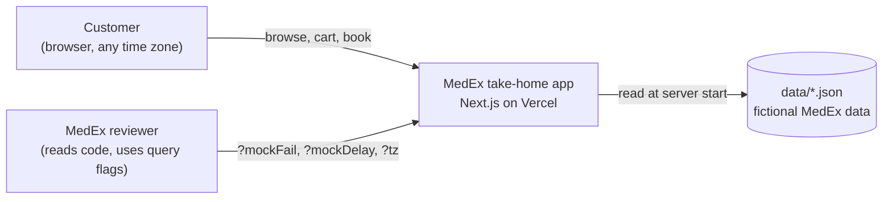
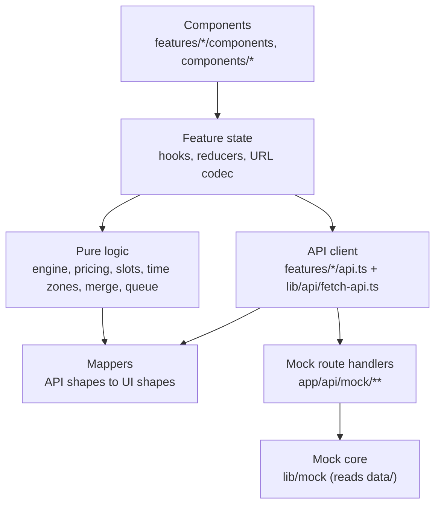
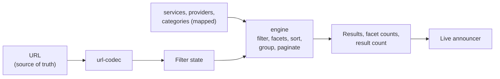
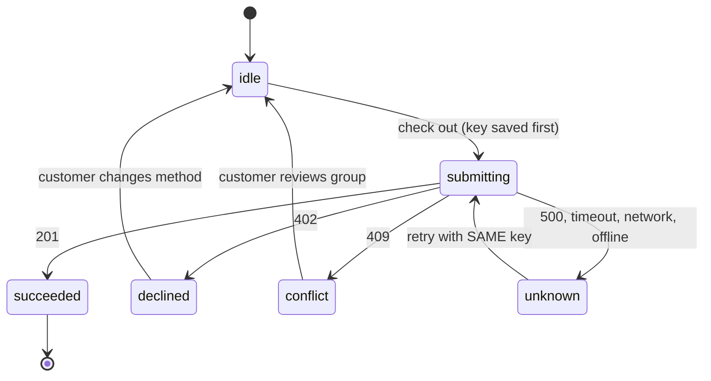
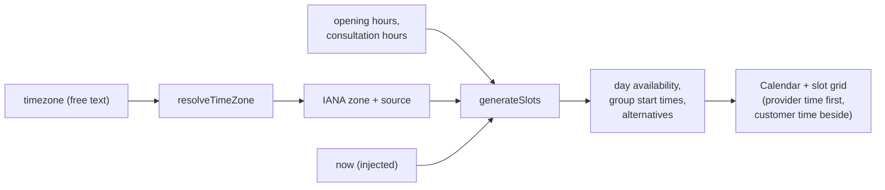

# Architecture

How the MedEx take-home is put together, and why. Written in the spirit of the C4 model (https://c4model.com/): context, containers, components, then the cross-cutting rules. The reasoning behind each big choice is in `docs/adr/`.

Read this before starting a work package. Update it in the same commit when a package changes the structure.

## 0. Architecture style

**In one sentence:** a feature-based modular monolith on the Next.js App Router, where each feature has a functional core (pure, tested business logic) inside an imperative shell (fetching, React state, the URL, storage), with a mapping layer at the API edge acting as an anti-corruption layer. It is documented with the C4 model and Architecture Decision Records.

| Named pattern | What it means here | Where to see it | Study |
|---|---|---|---|
| Modular monolith | One deployable app, split into modules (features) with clear boundaries, not micro-frontends | `src/features/services`, `cart`, `booking`; shared code in `src/lib` | https://martinfowler.com/bliki/MonolithFirst.html |
| Feature-based folders | Code grouped by feature, not by file type; a feature owns its api, types, mappers, logic and components | `src/features/<task>/` | https://github.com/alan2207/bulletproof-react (see `docs/project-structure.md`) and https://feature-sliced.design/ |
| Layered (presentation, domain, data) | UI, business rules and data access kept apart; dependencies point one way | Section 3 below | https://martinfowler.com/bliki/PresentationDomainDataLayering.html |
| Functional core, imperative shell | Decisions live in pure functions; side effects (fetch, clock, storage, DOM) live in a thin outer shell that calls them | `engine.ts`, `pricing.ts`, `slots.ts` (core); hooks and components (shell) | https://www.destroyallsoftware.com/screencasts/catalog/functional-core-imperative-shell |
| Anti-corruption layer | Raw API shapes are translated once into our own UI types, so messy or changing API data can't leak into the UI | `mappers.ts` in each feature turns `api-types.ts` shapes into the UI shapes in `types.ts` | https://learn.microsoft.com/en-us/azure/architecture/patterns/anti-corruption-layer |
| Ports and adapters (light) | The UI depends on `api.ts` functions, not on how data is fetched; swapping the mock for MedEx's real API changes the adapter, not the features | `features/*/api.ts`, `src/lib/mock` | https://alistair.cockburn.us/hexagonal-architecture/ |
| Server-first rendering | Server Components render the first view; Client Components take over where interaction is needed | `/services` page reads `searchParams` on the server | https://nextjs.org/docs/app/getting-started/server-and-client-components |
| URL as state | Shareable view state lives in the URL, not in a store | Task 1 URL codec | https://nextjs.org/docs/app/api-reference/file-conventions/page |
| Finite state machine | Checkout moves through named states with allowed transitions only | Task 2 checkout reducer | https://statecharts.dev/ |
| Idempotency keys | Retrying a request can never create a second order | Task 2 checkout | https://docs.stripe.com/api/idempotent_requests |
| Test pyramid | Many fast unit tests on the core, few component tests, manual and optional end-to-end on top | Section 8 below | https://martinfowler.com/articles/practical-test-pyramid.html |
| C4 model and ADRs | How the architecture is documented | This file and `docs/adr/` | https://c4model.com/ and https://adr.github.io/ |

### Why it is built this way

- *Why not micro-frontends?* Three small features, one team of one, one deploy. Micro-frontends solve team and deploy independence problems we don't have; they would add build and runtime cost for nothing. A modular monolith keeps the option open, since each feature folder is already self-contained.
- *Why no Redux or Zustand?* Each kind of state has a natural home: filters in the URL, cart lines in a reducer, checkout attempts in `localStorage`, selections in component state (table in section 5). A global store would duplicate the URL in Task 1 and add indirection everywhere else.
- *What would change with a real backend?* Delete `src/app/api/mock` and `src/lib/mock`, point each `api.ts` at the real endpoints, keep the mappers. The core and the UI don't change. Facet counting might move to the server if the catalogue grew far beyond 3,200 services (ADR 0006).
- *Isn't this just clean architecture or hexagonal?* It borrows the key idea, dependencies point inwards to pure rules, but stays light: no interfaces, classes or dependency injection containers, because TypeScript functions and modules already give us the seams we need, and the code has to be explainable live.
- *Where is the domain logic?* In the pure files of each feature: `pricing.ts`, `engine.ts`, `url-codec.ts` (Task 1); subtotals, `quantity-queue.ts`, the checkout reducer, merge (Task 2); `time-zone.ts`, `slots.ts`, availability (Task 3).
- *How do you stop the rules leaking into components?* Components receive mapped UI types only, ESLint blocks imports from `data/`, and the reviewer checks for business rules in components.

## 1. Context

There is no real backend. A mock API inside the same Next.js app stands in for MedEx's servers, with realistic latency and failure on demand. Nothing leaves the app at runtime: no analytics, no third-party APIs.

## 2. Containers

One Next.js App Router project, deployed as one Vercel app.

| Container | Runs where | Responsibility |
|---|---|---|
| Pages (`src/app/services`, `/cart`, `/booking`, `/`) | Server render, then client | Read the URL, render the first view, hand over to client components |
| Feature code (`src/features/<task>`) | Server and client | API calls, mapping, pure business logic, UI components |
| Mock API (`src/app/api/mock/**`) | Server (route handlers) | Serve the data with the same field names as MedEx's API; apply latency and failure |
| Mock core (`src/lib/mock`) | Server | The only code that reads `data/`; latency, faked failures, in-memory state. `flags.ts` is the exception: pure, no `data/` imports, also used by the client |
| Fetch wrapper (`src/lib/api`) | Client | `fetchApi` and `ApiResult`: reads the page's mock flags, picks the failure for each call, returns a typed result. `isOffline()` for the offline banner |
| Shared libs (`src/lib/money`, `src/lib/a11y`) | Both | Money maths and formatting; the live announcer (`LiveAnnouncerProvider` in the root layout, `useAnnounce()` in components) |
| Shared UI (`src/components/ui`, `src/components/states`) | Client | shadcn components adjusted to the design tokens; the shared states: `EmptyState`, `ErrorState`, `OfflineBanner` (via `useIsOffline` in `src/lib/api`) and `Skeleton` |
| Browser storage | Client | Checkout attempts (Task 2) so a reload shows the true state |

## 3. Layers and the direction of dependencies

Each layer only imports from the layers below it.

Rules that follow from this:

- Components never see raw API field names. They receive UI shapes from mappers.
- Pure logic never fetches, never reads the clock, never touches the DOM. It takes inputs (including `now`) and returns values, so it is easy to test and easy to change live.
- Only `src/lib/mock` and `scripts/` import from `data/`. ESLint enforces it.

## 4. Components per task

### Task 1: Service Explorer

- `mapCatalogue` (`mappers.ts`) turns the three endpoint responses into one `Catalogue` holding only what a customer can see. The visibility rule (service, provider, category and subcategory all active) lives there and nowhere else in the app. `scripts/audit-data.ts` restates it on purpose, to check the spec's counts against the raw data.
- `url-codec.ts` turns the URL into a `ServiceQuery` plus the compare selection, and back. Defaults are left out; bad values and anything not in the mapped catalogue are dropped quietly, so it needs the catalogue to parse.
- The same `engine` runs on the server (first render from `searchParams`, so no unfiltered flash) and on the client (live facet counts).
- Prices are computed once at mapping time with big.js and stored on each UI service, with every amount the price filter checks (`payableAmounts`) and the normalised search text per field (`search`).
- `runQuery` (`engine.ts`) takes the `Catalogue` and a `ServiceQuery` and returns the page of provider groups, the counts and `facetCounts`. Search is applied once, first, since it has no counts. Results come from one pass with every filter. Each facet's counts come from one more pass with that facet's filter cleared (`withoutFacet`). Matches are sorted once, then grouped by provider in that order, so groups follow their best service.
- The mobile drawer runs the engine on a pending copy of the filters to show "Show N results" before applying.

### Task 2: Cart and checkout

- One state machine per group. "Check out all" runs groups one at a time.
- The attempt record (key, status, order id) is written to `localStorage` before each request. On reload, unfinished attempts are re-sent with the same key.
- Quantity changes go through a per-line queue: one request in flight, latest intent wins, stale responses ignored.
- Subtotals are recomputed from lines on the client, one per currency.

### Task 3: Booking

- All times are wall-clock in the provider's zone. Conversion to the customer's zone happens only for display.
- `dayOffset` values become real dates when the mock starts, with day 0 being today at the provider.

## 5. Where state lives

| State | Lives in | Why |
|---|---|---|
| Task 1 filters, sort, page, expanded groups, compare selection | URL | Reload, share, back and forward must restore the view |
| Task 1 pending drawer selection | Component state | Not applied until "Show results" |
| Cart lines | React state, seeded from `GET /cart` | Optimistic updates with rollback |
| Checkout attempts | `localStorage` | Must survive a reload or a closed tab |
| Booking selections (date, specialist, people, slot) | Component state, kept through errors and 409s | The customer never starts over |
| Mock server state (orders, bookings) | In memory on the server | Simple; limits on Vercel are covered by ADR 0007 |
| Customer time zone | Browser, overridable with `?tz=` | Reviewers anywhere can replay the Kathmandu story |

## 6. Cross-cutting concerns

| Concern | Where | Rule |
|---|---|---|
| Money | `src/lib/money` | big.js only; `Money = { amount, currency }`; never mix currencies (ADR 0004): `addMoney` and `compareMoney` throw on two currencies. Rounding is half-up to 2 dp, once, in `formatMoney`. Every currency uses en-US grouping (`23,009.50 INR`, not Indian lakh grouping) so the three currencies read the same way in one list. `formatMoney` never prints "Free": the price kind decides that |
| Time | `src/features/booking` + Luxon | Resolve zones once; inject `now`; never pass raw zone strings to `Intl` (ADR 0005) |
| Errors | `src/lib/api/fetch-api.ts` | Every call returns a typed result: `ok`, `offline`, `network`, `server`, `conflict`, `declined`. UI branches on the kind, never on message text |
| Failure injection | `src/lib/mock/flags.ts`, `src/lib/api/fetch-api.ts`, `src/lib/mock/latency-and-failure.ts` | `?mockDelay`, `?mockFail=<endpoint>[@<group>]:<kind>[:once]`, `?mockOffline=1`. The client picks the failure and forwards only `mockDelay` and `mockStatus`; the server keeps no flag state (ADR 0003, ADR 0011) |
| Accessibility | everywhere | WCAG 2.2 AA; APG patterns; one shared polite live region; focus moved on purpose |
| Design tokens | `src/app/globals.css` | CSS variables from `docs/design-system.md`; no raw colour values in components |
| Security | `next.config` | Security headers, no `x-powered-by`, no secrets, no runtime third-party calls |

## 7. Quality attributes and how they are checked

| Attribute | Target | How it is checked |
|---|---|---|
| Correctness on awkward data | Every audit case handled | `npm run audit:data`, unit tests named after the case |
| Performance (Task 1) | about 100 ms per filter change, CLS 0 | Vitest bench, `performance.measure`, DevTools at 4x CPU throttle, web-vitals |
| Accessibility | No serious or critical axe issues | axe DevTools per route, keyboard-only walkthrough, screen reader spot checks |
| Reliability (Task 2) | No duplicate orders, true state after reload | Reducer and idempotency tests, manual reload during checkout |
| Maintainability | Any file can be read and changed without deep context | Plain code, small pure functions, a comment on every non-obvious rule |

## 8. Testing strategy

A testing pyramid sized for a take-home: most confidence comes from fast unit tests on pure logic, because that is where the awkward data lives. Tools and reasons are in ADR 0009. The required tests per task are listed at the end of each spec.

| Level | Tool | What belongs here | Where | Runs |
|---|---|---|---|---|
| Unit | Vitest | Every pure function with a business rule: pricing, engine and facets, URL codec, subtotals, quantity queue, checkout reducer, merge, time zone resolver, slot generator, availability | `*.test.ts` next to the file | `npm test`, CI on every push |
| Real data | Vitest | The engine over the real `data/` file: 2,853 visible, Other, ultrasound, new providers last | `scripts/*.test.ts` (only `scripts/` and `src/lib/mock` may read `data/`) | `npm test`, CI |
| Mock API | Vitest | Route helpers: flag parsing, `:once`, idempotency (same key, same order), `dayOffset` to dates, current booking marked | `src/lib/mock/*.test.ts`; `:once` end to end in `src/lib/api/fetch-api.test.ts` | `npm test`, CI |
| Component | Vitest + Testing Library | Only where behaviour is the point: five fast "+" taps, focus after removing a line, drawer "Show N results" before applying | `*.test.tsx` next to the component | `npm test`, CI |
| Benchmark | Vitest bench | Task 1 engine over 3,200 services; median and p95 | `engine.bench.ts` | `npm run bench`, by hand |
| Data audit | `scripts/audit-data.ts` | Every count in the specs' data audits | `scripts/` | `npm run audit:data` |
| Accessibility | axe DevTools, keyboard, NVDA or VoiceOver | No serious or critical axe issues; keyboard-only walkthrough per route; live region and grid announcements | Manual, results in the README | Per task, before tagging |
| End to end | Playwright + axe (Could item, CR-03) | Three flows only, if time allows: Task 1 filters survive a reload; Task 2 partial failure, retry, one order per group; Task 3 409 keeps selections and offers alternatives | `e2e/` | Only if built |

Rules for writing tests:

- Name tests after the case they protect, in plain words: `"service 0001 shows 5,970.60 THB"`, `"Dr. Rana has no slots on Friday"`.
- Test behaviour through public functions or what the user sees (Testing Library queries by role and label), not internals.
- Time-dependent tests inject `now`. Any test that reads the real clock is a bug (risk R6).
- One fixture per awkward case, built from the real data's shape, kept small.
- No snapshot tests: they are hard to explain and easy to approve without reading.
- Full coverage is not a goal. A missing test for a case listed in a spec is a defect; a missing test for a trivial getter is fine.

## 9. Extension points

Where common changes would go:

- New Task 1 filter: add to the filter state type, the URL codec, the engine's filter list and facet list, then the panel. Tests in `engine.test.ts`.
- New currency: `src/lib/money` currency list and formatter; nothing else should need to change.
- New payment method: the checkout request type, the mock handler, and the payment choice component.
- Different slot length or buffer: data only; the slot generator reads them.
- New time zone format: one more step in `resolveTimeZone`, one more test row.
